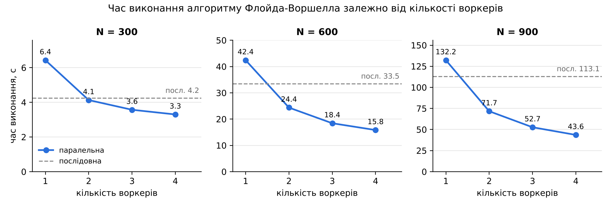

# Алгоритм Флойда-Воршелла на PARCS-Python у Google Cloud

Лабораторна робота з курсу «Розподілене паралельне програмування».
Тут реалізовано послідовний і паралельний алгоритм Флойда-Воршелла
(матриця найкоротших відстаней між усіма парами вершин) для системи
**ПАРКС (PARCS-Python)**. Система розгортається в **Google Cloud Platform (Compute Engine)**,
а час виконання порівнюється для різної кількості воркерів.

## Структура

```
solutions/
  floyd_solver.py       паралельна версія (основна): Map/Reduce без пересилання всієї матриці
  floyd_sequential.py   послідовна версія (лише майстер), базова для порівняння
  floyd_naive.py        наївна паралельна версія, як у cloud_lab (для порівняння у звіті)
inputs/
  example_4.txt         маленький приклад 4x4 для перевірки
  graph_100.txt         випадкові графи (щільність 0.3, seed 42)
  graph_200.txt         100-200 -- для наївної версії
  graph_300.txt         300-900 -- для основних тестів
  graph_600.txt
  graph_900.txt
tools/
  generate_graph.py     генератор вхідних матриць
  benchmark.py          автоматичне тестування в хмарі через REST API PARCS
  local_test.py         локальна перевірка коректності (без хмари)
deploy/
  create_cluster.sh     створення кластера в GCP однією командою
  delete_cluster.sh     видалення всіх ресурсів
results/                сюди benchmark.py зберігає results.csv
```

## Задача і алгоритм

Дано зважений орієнтований граф з N вершинами у вигляді матриці суміжності D
(`INF` означає, що ребра немає). Потрібно знайти найкоротші відстані між усіма парами вершин.

**Послідовний алгоритм.** Для кожної проміжної вершини k = 0..N-1:

```
D[i][j] = min(D[i][j], D[i][k] + D[k][j])   для всіх i, j
```

Складність O(N³), пам'ять O(N²).

**Паралельний алгоритм (`floyd_solver.py`).** Базується на схемі з `cloud_lab`: матриця ділиться
на P блоків рядків, оновлення рядків виконують воркери (`mymap`), майстер синхронізує ітерації
(`myreduce`). Від `cloud_lab` відрізняється трьома виправленнями:

1. **Матриця не пересилається на кожній ітерації.** Кожен воркер отримує свій блок рядків один раз
   (`myinit`) і зберігає його в пам'яті. На ітерації k майстер розсилає лише k-й рядок (`mymap(k, pivot_row)`).
   Воркер, якому належить рядок k+1, повертає його, і `myreduce` передає цей рядок як pivot для
   наступної ітерації. Наприкінці майстер збирає блоки (`mycollect`).
2. **«Немає ребра» — окремий маркер `INF`** (`float('inf')`), а не число 999. Недосяжні пари
   у відповіді теж позначаються `INF`, а їхня кількість записується в заголовок (`unreachable_pairs`).
3. **Є окрема послідовна версія** (`floyd_sequential.py`), яка виконується на такій самій ВМ.
   Прискорення рахується відносно неї, а не відносно запуску з 1 воркером.

| Версія | Обчислення на воркер за ітерацію | Обмін даними за ітерацію |
|---|---|---|
| `floyd_naive.py` (як у cloud_lab) | O(N²/P) | O(N²): вся матриця туди й назад |
| **`floyd_solver.py`** | O(N²/P) | **O(P·N)**: лише k-й рядок |

Оцінка часу паралельної версії: T(P) ≈ T_seq / P + N · t_sync, де t_sync — затримка однієї
синхронізації. Чим більше N, тим ближче прискорення до лінійного.

Для порівняння з наївною версією у звіті (вона повільна, тому беремо менші графи):
`python3 tools/benchmark.py http://IP:8080 --solution solutions/floyd_naive.py --inputs inputs/graph_100.txt inputs/graph_200.txt --out results/naive.csv`

Формат вихідного файлу: рядки `#` із заголовком (N, кількість воркерів, час, контрольна сума),
а за ними матриця відстаней.

## Результати (Google Cloud, n1-standard-1)

Повний час задачі в секундах; S — прискорення відносно послідовної версії.

| Воркерів | N=300, с | S | N=600, с | S | N=900, с | S |
|---|---|---|---|---|---|---|
| послідовно | 4.25 | 1.00 | 33.46 | 1.00 | 113.06 | 1.00 |
| 1 | 6.43 | 0.66 | 42.41 | 0.79 | 132.23 | 0.86 |
| 2 | 4.13 | 1.03 | 24.37 | 1.37 | 71.67 | 1.58 |
| 3 | 3.57 | 1.19 | 18.42 | 1.82 | 52.68 | 2.15 |
| 4 | 3.30 | 1.29 | 15.83 | 2.11 | 43.59 | 2.59 |



## Покрокова інструкція

### 1. Підготовка

1. Потрібен проєкт Google Cloud із підключеним білінгом (підходить free trial).
2. Відкрийте **Cloud Shell**: кнопка `>_` угорі консолі Google Cloud.
3. Завантажте код і виберіть проєкт:
   ```bash
   git clone https://github.com/kateryna-nalivayko/cloud_computing_lab1.git
   cd cloud_computing_lab1
   gcloud config set project <PROJECT_ID>
   ```

### 2. Розгортання PARCS у хмарі

```bash
bash deploy/create_cluster.sh 6
```

Скрипт попросить ваш IP: відкрийте https://ifconfig.me у браузері й вставте те, що там показано.
Веб-інтерфейс буде доступний лише з цієї адреси. Далі скрипт сам:

- вмикає Compute Engine API;
- створює правила firewall: внутрішній трафік між вузлами і порт 8080 лише для вас;
- створює Cloud NAT, щоб воркери без зовнішніх IP могли завантажити Docker-образ;
- створює ВМ `parcs-master` і `parcs-worker-1..6` (n1-standard-1, Container-Optimized OS)
  з контейнером `hummer12007/parcs-node` у режимі `--net=host`;
- чекає, поки воркери зареєструються, і друкує адресу `http://<IP>:8080`.

Кількість воркерів (за замовчуванням 6) обрано під ліміт free trial у 8 vCPU: 1 майстер + 6 воркерів = 7 vCPU.

### 3. Ручний запуск (для скриншотів у звіт)

1. Відкрийте `http://<IP майстра>:8080` → **Workers**: має бути видно 6 воркерів.
2. **Add Job**: введіть назву, як *Solution* виберіть `solutions/floyd_solver.py`,
   як *Input* — `inputs/graph_600.txt`, і натисніть Add.
3. **Jobs**: дочекайтеся завершення і натисніть **Output**. У перших рядках файлу буде час виконання.
4. Щоб змінити кількість воркерів, натисніть **Disable** біля зайвих воркерів на сторінці Workers.
5. Послідовна версія запускається так само, тільки з файлом `solutions/floyd_sequential.py`.

### 4. Автоматичне тестування

```bash
python3 tools/benchmark.py http://<IP майстра>:8080
```

Скрипт для кожного графа (300, 600, 900 вершин) запускає послідовну версію, а потім паралельну
з 1, 2, … 6 воркерами (≈15–25 хв; з `--repeats 3` кожен запуск повторюється 3 рази і береться медіана). Результати
зберігаються в `results/results.csv` (час, прискорення, ефективність, перевірка коректності)
і друкуються таблицею. Файл можна завантажити з Cloud Shell через меню ⋮ → **Download**.

### 5. Видалення кластера (обов'язково!)

```bash
bash deploy/delete_cluster.sh
```

## Локальна перевірка (необов'язково)

```bash
pip install Pyro4
python tools/local_test.py inputs/graph_200.txt --workers 1 2 4
```

Скрипт емулює PARCS: кожен воркер працює окремим процесом із Pyro4-демоном. Він порівнює результат
паралельної версії з послідовною та з еталонною реалізацією.

Згенерувати свій граф:

```bash
python tools/generate_graph.py 1000 --density 0.3 --seed 7 -o inputs/graph_1000.txt
```

## Якщо щось пішло не так

| Проблема | Що зробити |
|---|---|
| `Quota 'CPUS' exceeded` | Створіть менше воркерів: `bash deploy/create_cluster.sh 4` |
| `Billing ... not enabled` | Прив'яжіть проєкт до білінг-акаунта: Billing → My projects |
| Воркери не з'являються у Workers | Зачекайте 3–5 хв. Логи: `gcloud compute ssh parcs-worker-1 --tunnel-through-iap -- sudo docker logs parcs` |
| Сторінка `:8080` не відкривається | Змінився ваш IP: запустіть `create_cluster.sh` ще раз, і він оновить правило firewall |
| Задача завершилась з помилкою | Сторінка Jobs показує причину. Логи майстра: `gcloud compute ssh parcs-master -- sudo docker logs parcs` |
